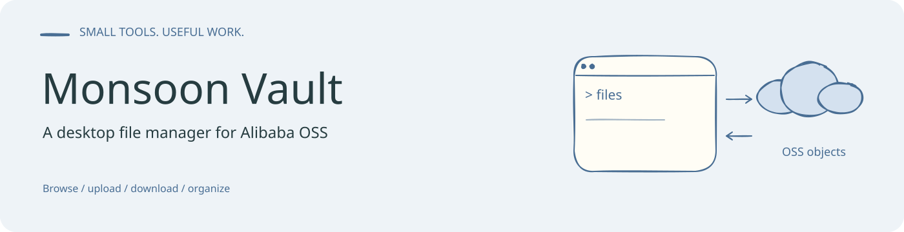
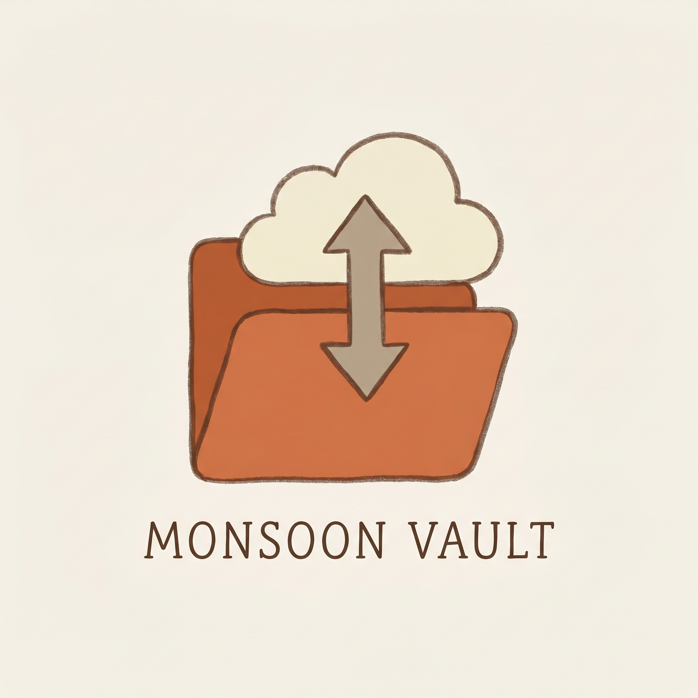
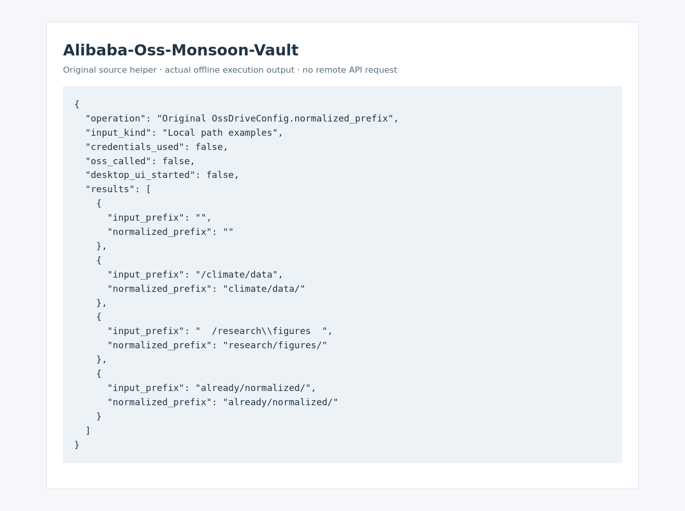

<!-- readme-visual-refresh:banner -->

<!-- /readme-visual-refresh:banner -->

# Monsoon Vault



> A Windows desktop file manager for Alibaba OSS.  
> Browse, upload, download, copy, move, rename, and organize OSS objects with an Explorer-like workflow.


## Overview

Monsoon Vault turns Alibaba OSS into a practical desktop net-disk experience on Windows.

Instead of browsing objects through scripts or notebooks, it gives you a single-pane file manager with familiar desktop interactions:

- double-click folders to enter
- double-click files to download
- upload files and folders
- drag and drop from local or remote desktop sessions
- copy, cut, paste, rename, and delete
- package everything as a standalone Windows `exe`

## Features

- Explorer-style single-pane file browser
- Alibaba OSS prefix scanning with virtual folder structure
- Multi-select file and folder operations
- File upload and folder upload
- Drag-and-drop upload
- Single file, multi-file, and recursive folder download
- Copy path to clipboard
- Copy / cut / paste / rename / delete
- New folder creation
- Right-click context menu
- Keyboard shortcuts

## Quick Start

### Run from source

```powershell
python -m pip install -r requirements.txt
Copy-Item .\oss_drive_config.example.json .\oss_drive_config.json
python run_oss_drive.py
```

### Build the Windows executable

```powershell
powershell -ExecutionPolicy Bypass -File .\build_exe.ps1
```

After build:

```powershell
.\dist\OssDrivePreview\OssDrivePreview.exe
```

## Configuration

Create `oss_drive_config.json` from the example template in the project root:

```powershell
Copy-Item .\oss_drive_config.example.json .\oss_drive_config.json
```

Then edit it with your OSS credentials and bucket settings:

```json
{
  "app_title": "Monsoon Vault",
  "brand_tagline": "A desktop OSS drive for browsing and organizing bucket content.",
  "access_key_id": "YOUR_ACCESS_KEY_ID",
  "access_key_secret": "YOUR_ACCESS_KEY_SECRET",
  "endpoint": "oss-cn-beijing.aliyuncs.com",
  "region": "cn-beijing",
  "bucket_name": "your-bucket",
  "start_prefix": "your/prefix/",
  "signed_url_ttl_seconds": 3600,
  "preview_max_bytes": 3145728,
  "download_dir": "downloads/oss_drive_files",
  "cache_dir": "downloads/oss_drive_cache"
}
```

## Shortcuts

| Shortcut | Action |
| --- | --- |
| `F5` | Refresh |
| `Alt + Up` | Go to parent folder |
| `Ctrl + C` | Copy selection |
| `Ctrl + X` | Cut selection |
| `Ctrl + V` | Paste into current folder |
| `Ctrl + Shift + C` | Copy OSS path |
| `Ctrl + Shift + N` | New folder |
| `Ctrl + U` | Upload file |
| `F2` | Rename |
| `Delete` | Delete selection |

## Project Structure

```text
.
├─ oss_drive/
│  ├─ assets/
│  ├─ client.py
│  ├─ config.py
│  ├─ main.py
│  └─ models.py
├─ docs/
│  └─ images/
├─ oss_drive_config.example.json
├─ run_oss_drive.py
├─ build_exe.ps1
└─ requirements.txt
```

## Notes

- Empty folders are represented in OSS with a hidden marker object named `.ossdrive_keep`.
- The desktop app currently prefers `oss_drive/assets/app_icon.png` as its runtime icon.
- `oss_drive_config.json` is intentionally gitignored so real credentials do not enter the repository.
- For public release, replace long-lived AccessKey credentials with STS or another short-lived credential flow.

<!-- readme-visual-refresh:artwork-source -->
[Editable banner artwork · Excalidraw](assets/readme/banner.excalidraw)
<!-- /readme-visual-refresh:artwork-source -->


<!-- readme-visual-refresh:execution -->
## Demonstration captured on EHPC · 17 October 2026



Original configuration/path-normalization helper executed on explicit example values. No OSS credentials, bucket access, upload or download was used.

[Execution record and checksums](assets/readme/execution-record.json).
<!-- /readme-visual-refresh:execution -->
